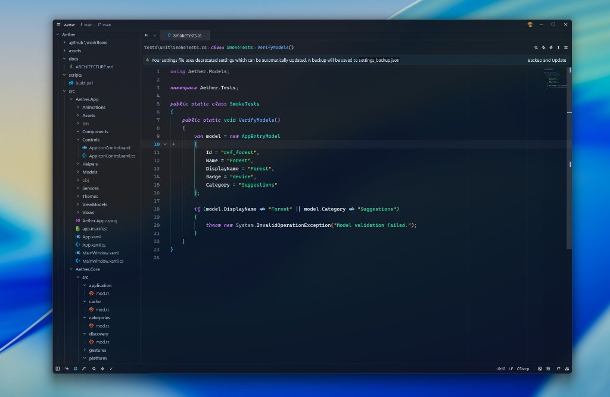

# zed-config

Personal Zed Editor configuration for Windows 11 with blurred background, Material icons, smooth cursor animation, C/C++ & SQL tooling, and a PowerShell 7 profile.



## Features

- **Blurred UI (`Cyber Glass Dark (Blur)`)**: Uniform translucent background across title bar, panels, editor, tabs, and status bar.
- **Typography & Animations**: `Cascadia Code` in the editor, `JetBrainsMono NF` in the terminal, ligatures (`calt`, `ss01`), smooth cursor animation, and rounded selections.
- **Dev Components**: Material Icon Theme, inline diagnostics, inlay hints, inline git blame, code lens, rainbow brackets, indent guides, minimap, and sticky scroll.
- **PowerShell 7 Profile**: Two-line prompt with git status, `PSReadLine` inline history suggestions, `zoxide`, `fzf`, `eza`, `bat`, `ripgrep`, and `lazygit`.

## Files

```text
zed-config/
├── assets/
│   └── preview.jpg
├── powershell/
│   └── Microsoft.PowerShell_profile.ps1
├── themes/
│   └── cyber-glass-blur.json
├── tools/
│   ├── cpp-build.cmd
│   ├── cpp-run.cmd
│   ├── sql-run.cmd
│   └── sql-shell.cmd
├── keymap.json
├── settings.json
└── tasks.json
```

## Extensions

Declared in `auto_install_extensions` inside `settings.json`:

`material-icon-theme`, `astro`, `csharp`, `csv`, `git-firefly`, `html`, `log`, `powershell`, `sql`, `sqlserver`, `svelte`, `swift`, `toml`, `windows-batch`

## Setup (Windows 11)

1. Install the font and CLI tools:
   ```powershell
   winget install Microsoft.PowerShell DEVCOM.JetBrainsMonoNerdFont ajeetdsouza.zoxide junegunn.fzf BurntSushi.ripgrep.MSVC sharkdp.bat eza-community.eza JesseDuffield.lazygit GitHub.cli
   ```
2. Copy `settings.json`, `keymap.json`, `tasks.json`, `themes/`, and `tools/` to `%APPDATA%\Zed\`.
3. Copy `powershell/Microsoft.PowerShell_profile.ps1` to `Documents\PowerShell\Microsoft.PowerShell_profile.ps1`.
4. Open Zed.
